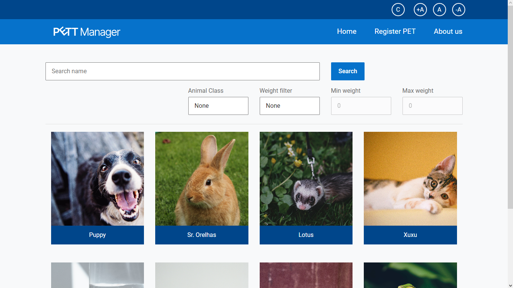
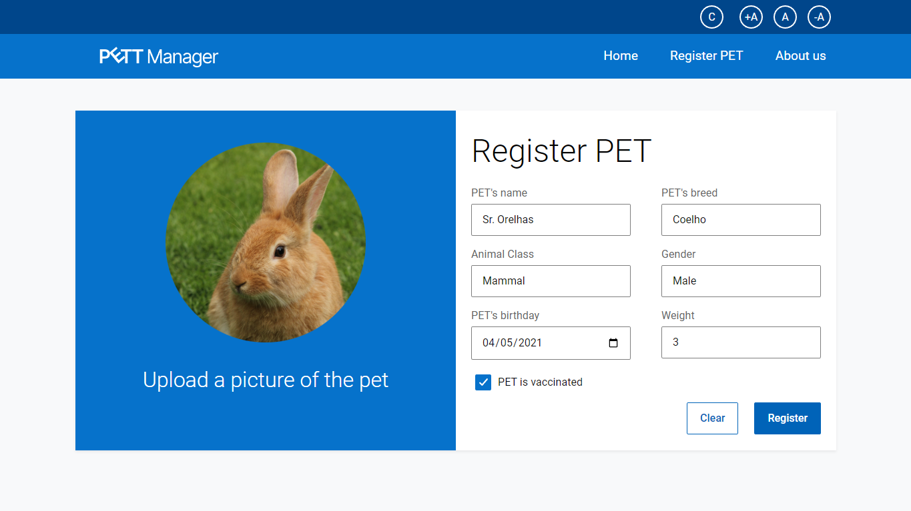

---

<h1 align="center">
    
</h1>

---

## 💻 Sobre o projeto

🐶 Pet Manager - É um projeto web para administração das informações de animais de estimação.
Neste projeto são praticados os conhecimentos sobre Spring Boot, TypeScript, JPA e Angular. Suas funcionalidades são voltadas para a manutenção dos dados de animais de estimação, permitindo a interação com o usuário por meio de uma interface web feita com Angular que consome uma API desenvolvida com Spring Boot.

Projeto final do *Lead Mentoring*, projeto da [LeadDell](https://leadfortaleza.com.br/portal), e tem como objetivo implemntar todos os conceitos estudados durante a mentoria.

---

## ⚙️ Funcionalidades

- [x] Cadastrar animais de estimação
  - Tipo de animal, espécie e gênero
  - Nome, peso e confirmação de vacinação
  - Imagem do pet
- [x] Manipular Informações do Pet
  - Editar dados
  - Deletar dados
- [x] Pesquisar por pets
  - Filtrar por tipo de animal
  - Filtrar por peso
  - Filtrar por nome
- [x] Acessibilidade
  - Manipular o tamanho da fonte

---

## 🎨 Layout

<p align="center" style="display: flex; align-items: flex-start; justify-content: center;">
  

  
</p>

---

## 🚀 Como executar o projeto

Este projeto é divido em duas partes:
1. [Backend](https://github.com/VictorM-Coder/PET-Manager--back-end) 
2. [Frontend](https://github.com/VictorM-Coder/PET-Manager--front-end)

💡Para que o frontend execute corretamente é necessário que o backend esteja executando

### Pré-requisitos
- Java JDK 13
- Maven
- Spring Boot
- Servidor MySQL (as configurações e propriedades podem ser atualizadas)

Além disto é bom ter um editor para trabalhar com o código como [VSCode](https://code.visualstudio.com/)

#### 🎲 Configurando o Backend (servidor)

```bash

# Clone este repositório
$ git clone https://github.com/VictorM-Coder/PET-Manager--back-end.git

# Configure o arquivo properties com os dados do seu servidor
spring.datasource.url= <url>
spring.datasource.username= <user>
spring.datasource.password= <password>

# Inicie a aplicação

# O servidor inciará na porta:8080 - acesse http://localhost:8080 

```

#### 🧭 Rodando a aplicação web (Frontend)

```bash

# Clone este repositório
$ git clone https://github.com/VictorM-Coder/PET-Manager--front-end.git

# Acesse a pasta do projeto e inicie a aplicação com
$ ng serve

# A aplicação será aberta na porta:4200 - acesse http://localhost:4200

```

---

## 🛠 Tecnologias

As seguintes ferramentas foram usadas na construção do projeto:

#### **Frontend** 

-   **[Angular](https://angular.io)**
-   **[TypeScript](https://www.typescriptlang.org)**
-   **[Dell Design System](delldesignsystem.com)**
-   **[Bootstrap](https://getbootstrap.com)**

#### **Backend**

-   **[Java Persistense API](https://docs.oracle.com/javaee/6/tutorial/doc/bnbpz.html)**
-   **[Spring Boot](https://spring.io/projects/spring-boot)**
-   **[MySQL](https://www.mysql.com)**

#### **Utilitários**

-   Protótipo:  **[Figma](https://www.figma.com/)**
-   Editor:  **[Visual Studio Code](https://code.visualstudio.com/)** & **[Intellij IDEA](https://www.jetbrains.com/pt-br/idea/)**
-   Teste de API:  **[Insomnia](https://insomnia.rest/)**
-   Fontes:  **[Roboto](https://fonts.google.com/specimen/Roboto)**

---

## ✌️ Autor

[Victor Martins](https://github.com/VictorM-Coder)
<div>
  <a href="https://www.instagram.com/iam_victor.martins/"></a> 
  <a href="https://www.linkedin.com/in/victor-martins-230864233/"></a> 

  ---
  
## 📝 Licença

Este projeto esta sobe a licença [MIT](./LICENSE).
